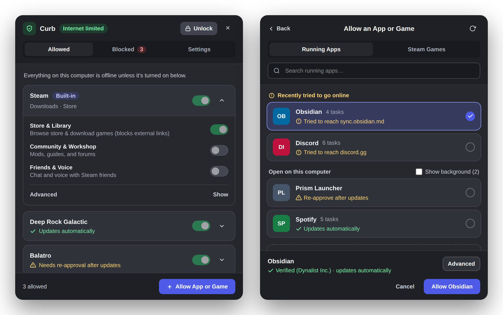

<div align="center">


# Curb

**Block everything. Allow only what matters.**

A lightweight, default-deny Windows & Linux internet limiter designed for setups where a trusted admin (a friend, partner, or parent) controls what can go online.

[](https://github.com/OceanEilonwy/curb/releases/latest)
[](https://github.com/OceanEilonwy/curb/releases/latest)
[](LICENSE)

<h3>
  <a href="https://github.com/OceanEilonwy/curb/releases/latest">Download Latest Release (Windows & Linux) &rarr;</a>
</h3>

<br />



</div>

---

## Why Curb?

Most internet blockers rely on browser extensions or domain blocklists that are trivial to bypass and constantly break games or desktop apps. **Curb flips the model:**

- **Default-deny at the OS firewall (WFP):** Blocks all IPv4 & IPv6 traffic across every network adapter—no kernel driver required.
- **Built for non-technical admins:** Pick open apps from a clean **Running Apps** list or auto-discovered **Steam Games**—no hunting through `AppData` folders. Technical knobs (`TCP/UDP`, DNS whitelists, hashes, sub-process scope) stay neatly tucked inside **Advanced**.
- **Survives game & app updates:** Automatically verifies Authenticode signatures so signed apps keep working after patches; unsigned binaries lock cleanly by SHA-256 hash.
- **Modular Steam preset:** Keeps downloads and multiplayer working reliably while locking Steam's built-in browser (`steamwebhelper.exe`) to a strict DNS whitelist with toggles for **Store**, **Community**, and **Friends**.
- **Separate Curb password:** Protected with Argon2id so a friend or accountability partner can hold the password without needing your Windows Administrator password.
- **Quiet in the taskbar:** Runs as a tiny `LocalSystem` service with a native **Slint** software-rendered UI (zero WebView2 or GPU overhead) that drops its window on close to stay at just a few megabytes of RAM.

---

## Quick Setup (Windows)

1. **[Download Curb for Windows](https://github.com/OceanEilonwy/curb/releases/latest)** (`curb-windows-x64-setup.exe`) and run the one-click installer—everything is bundled inside, and **no admin account is needed to install**.
2. Open **Curb** and choose your mode:
   - **Full Protection (Recommended):** One click + a single Windows Admin prompt sets up the locked system firewall automatically.
   - **Standard Mode (No Admin):** Starts immediately in your user account with zero admin needed (upgrade to Full Protection anytime in Settings).
3. Pick your **Curb password** right in the app and toggle on **Steam** or any apps and games you want online.

## Quick Setup (Linux)

Supported on all major `systemd` + `nftables` distributions (Ubuntu 22.04+, Debian 11+, Linux Mint, Pop!_OS, Fedora, RHEL/Rocky/Alma, openSUSE, Arch Linux, **CachyOS**, Manjaro, EndeavourOS, SteamOS) as well as **Void Linux (`runit`)** (glibc & musl), with first-class desktop support for **KDE Plasma**, **XFCE**, **GNOME**, **Sway**, **Mango (MangoWC)**, and **dwl**:

- **Ubuntu / Debian / Linux Mint / Pop!_OS (`.deb`):**
  ```bash
  sudo apt install ./curb_*_amd64.deb
  ```
- **Fedora / RHEL / openSUSE (`.rpm`):**
  ```bash
  sudo dnf install ./curb-*.x86_64.rpm   # or: sudo zypper install ./curb-*.x86_64.rpm
  ```
- **Arch Linux / CachyOS / Manjaro / EndeavourOS (`.pkg.tar.zst`):**
  ```bash
  sudo pacman -U ./curb-*-x86_64.pkg.tar.zst
  ```
- **Void Linux (`runit`, `.xbps`):**
  ```bash
  xbps-rindex -a ./curb-*.x86_64.xbps && sudo xbps-install -R . curb
  ```
- **Any other systemd or runit Linux distro (`.tar.gz`):**
  ```bash
  tar -xzf curb-*-linux-x86_64.tar.gz && cd curb-*-linux-x86_64 && sudo ./install.sh
  ```

Then launch **Curb** from your application menu (or `curb-app`) and click **Full Protection** (prompts once via Polkit `pkexec` to enable `curb.service` on systemd or `/var/service/curb` on Void runit). See [docs/LINUX_DESKTOPS.md](docs/LINUX_DESKTOPS.md) for CachyOS, Void Linux, KDE, XFCE, Sway, Mango, and dwl tips (floating rules, autostart, and Polkit agents).

### Uninstall (Linux)

Remove Curb's service (`systemd` or Void `runit`), `nftables` firewall rules, per-user desktop autostart & proxy settings (`gsettings`, KDE `kioslaverc`, `~/.config/environment.d/90-curb-proxy.conf`), saved data, and tarball-installed binaries in a single command:

```bash
sudo curb-cli uninstall --purge
```

*(Omit `--purge` to keep saved rules and password in `/var/lib/curb`. If Curb was installed via a distro package manager, `curb-cli uninstall --purge` cleans all config and prints the exact `apt`/`dnf`/`pacman`/`xbps-remove` command to unregister the package; removing the package directly also invokes `curb-cli uninstall` automatically.)*

<details>
<summary>Admin recovery (forgot Curb password?)</summary>

- **Windows:** From an elevated PowerShell prompt: `C:\ProgramData\Curb\bin\curb-cli.exe set-password` or `curb-cli.exe emergency-disable`.
- **Linux:** From a terminal: `sudo curb-cli set-password` or `sudo curb-cli emergency-disable`.

</details>

---

## Building from Source

Built in pure **Rust** with **Slint** (software renderer + native system tray). See [docs/ARCHITECTURE.md](docs/ARCHITECTURE.md) for the technical deep dive.

```bash
# Run workspace tests (core, service, CLI, and Slint UI)
cargo test --workspace

# Build all binaries (curb-service, curb-cli, curb-app)
cargo build --release --workspace

# Run the Slint UI in interactive demo mode (no Windows service required)
cargo run -p curb-app -- --demo
```

## License

GNU Affero General Public License v3.0 — see [LICENSE](LICENSE).
